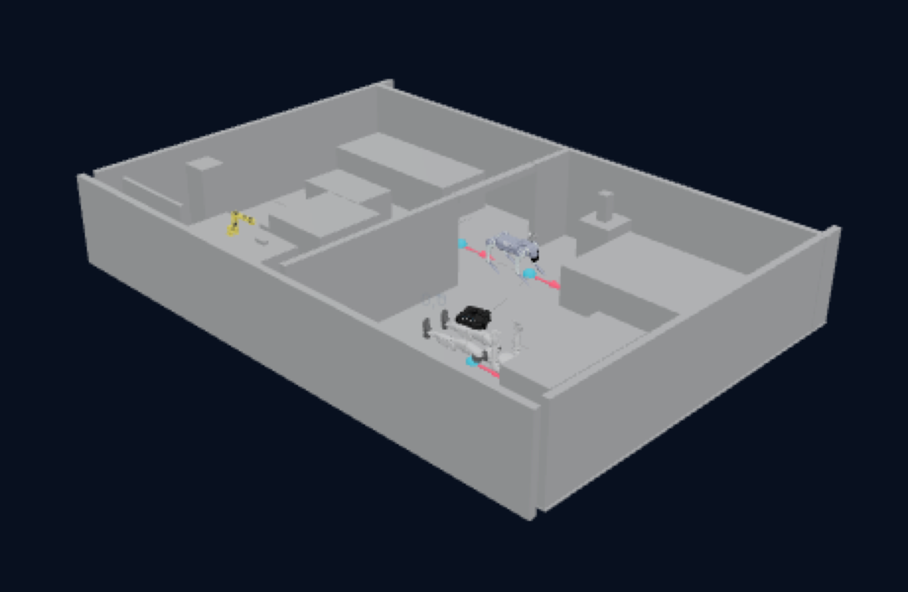
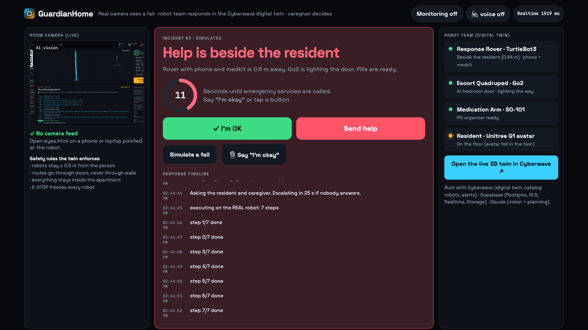

# GuardianHome

A real camera sees a fall, and a robot team responds inside a Cyberwave digital twin of the home.

## Demo





- **Open the live 3D environment (Cyberwave):** https://cyberwave.com/environment-viewer?uuid=ae980ceb-428a-4b37-898d-ffacd298dc75&public_key=i3dJzR62BTdSZAf-o2cas7aMuXeq1lqFIfptEI-isjQ
- **Live incident dashboard:** https://aryan-techie.github.io/twingate/guardian.html
- **Robot eyes (open on a phone pointed at the room):** https://aryan-techie.github.io/twingate/eyes.html

Built by **Aryan Jangra** at the Supabase x Cyberwave Builders Meetup, Delhi NCR, 14 Nov 2026.

## The problem

Falls kill about 684,000 people a year (WHO). For older people who live alone, the worst part is often the hours spent on the floor before anyone knows.

## What happens when someone falls

1. **A real camera sees it.** A phone (`eyes.html`) uploads a frame every 2 s to Supabase Storage. Claude vision judges each frame against the rule "is a person on the floor?", and the answer comes back as JSON (structured outputs).
2. **The twin reacts.** An incident row opens in Supabase, and the resident's avatar (a Unitree G1) falls in the Cyberwave apartment.
3. **The twin checks every route.** The rover's straight-line route was rejected because it went through the bedroom wall and stopped 0.22 m from the person. The rover was rerouted through the door and stopped 0.64 m away. Robots must always stay at least 0.5 m from a human.
4. **Help arrives.** The TurtleBot3 brings a phone and medkit. The Go2 lights the bedroom door for paramedics. The SO-101 readies the pill organizer. In testing, the robots were beside the resident 26 s after detection.
5. **People decide.** The resident says "I'm okay" (or taps), or the caregiver taps "Send help". If nobody answers in 25 s, it escalates to emergency services (simulated). Alerts are mirrored onto the Cyberwave twin.
6. **Stand down.** The robots return to their docks and the avatar stands up.

## The environment

The apartment has 35 twins from the Cyberwave catalog:
- **Rooms and furniture:** living room, bedroom, bed, sofa, TV, dining set, wardrobe.
- **Robots:** an SO-101 on the medicine counter, a TurtleBot3 on its charging dock, a Go2, and a Unitree G1 as the resident.
- **Sensors and navigation:** two room cameras, emergency-route floor markers, and the waypoints `dock → hall → bedroom_door → resident`.

`build_home.py` and `home_details.py` rebuild the whole scene from code.

## Run the demo

```bash
cp .env.example .env              # fill CYBERWAVE_API_KEY, SUPABASE_*, LLM_API_KEY (+ optional LLM_MODEL, LLM_BASE_URL), twin ids
python3 -m venv agent/.venv && agent/.venv/bin/pip install -r agent/requirements.txt
# Supabase SQL editor: run supabase/schema.sql, v2.sql, v3.sql, sentry.sql, guardian.sql
agent/.venv/bin/python build_home.py   # creates the Cyberwave apartment and prints twin ids
./run.sh                               # serves web/ on :8080 and starts the agent (GUARDIAN=1)
```

Then open `http://localhost:8080/guardian.html` and click **Simulate a fall**. For real detection, turn **Monitoring** on and open `eyes.html` on a phone.

## Architecture

```
phone camera (eyes.html) ──frames──▶ Supabase Storage ──▶ worker: Claude vision (structured JSON)
                                                              │ fall?
dashboard (guardian.html) ◀──Realtime── Supabase Postgres: incidents · events · missions · reports
                                                              │
                                              guardian.py: route checks (walls, door, ≥0.5 m to human)
                                                              │
                                Cyberwave SDK ──▶ twin scene (rover, Go2, G1 avatar) + SO-101 joints + alerts
```

## Stack

- **Cyberwave Python SDK** (`cyberwave==0.7.5`): catalog twins, scene placement, waypoints, simulated joint control, twin alerts.
- **Supabase:** Postgres, Row Level Security, Realtime, Storage, and SECURITY DEFINER functions.
- **Claude Opus 5.5:** vision with structured outputs, plus tool-use planning.
- **Safety:** shares the TwinGate layer, meaning rehearsal in the twin, a safety gate, an E-STOP over Supabase, and PIN-checked operator actions.

The full write-up, in plain words and technical detail, is in [docs/TWINGATE_EXPLAINED.md](docs/TWINGATE_EXPLAINED.md).

Runs in simulation today. The same code targets real robots by pointing the twin ids at live hardware.

## Bring your own model

No API key ships with this repo. Set `LLM_API_KEY` in `.env`. Optionally set `LLM_MODEL` (default `claude-opus-5-5`) and `LLM_BASE_URL` for any Anthropic-compatible endpoint. `MAX_SPEND_USD` caps spend.
